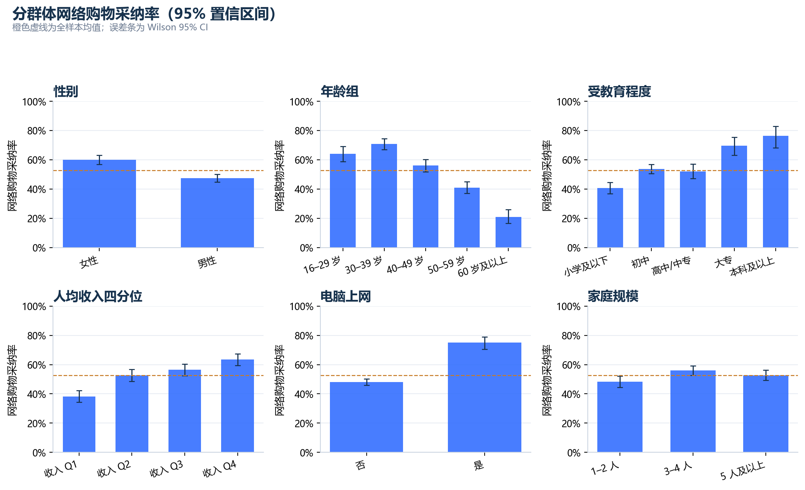
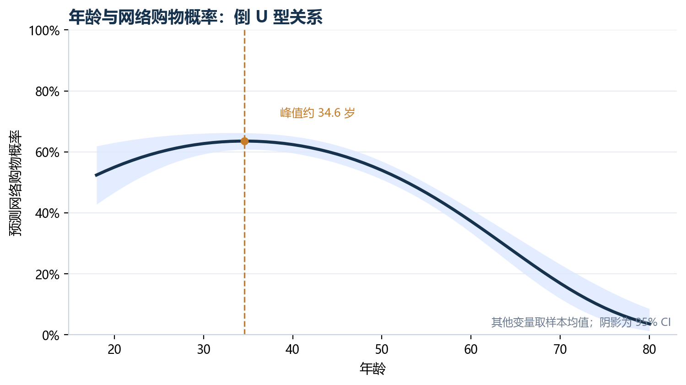
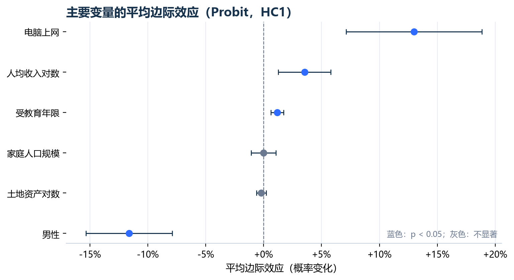
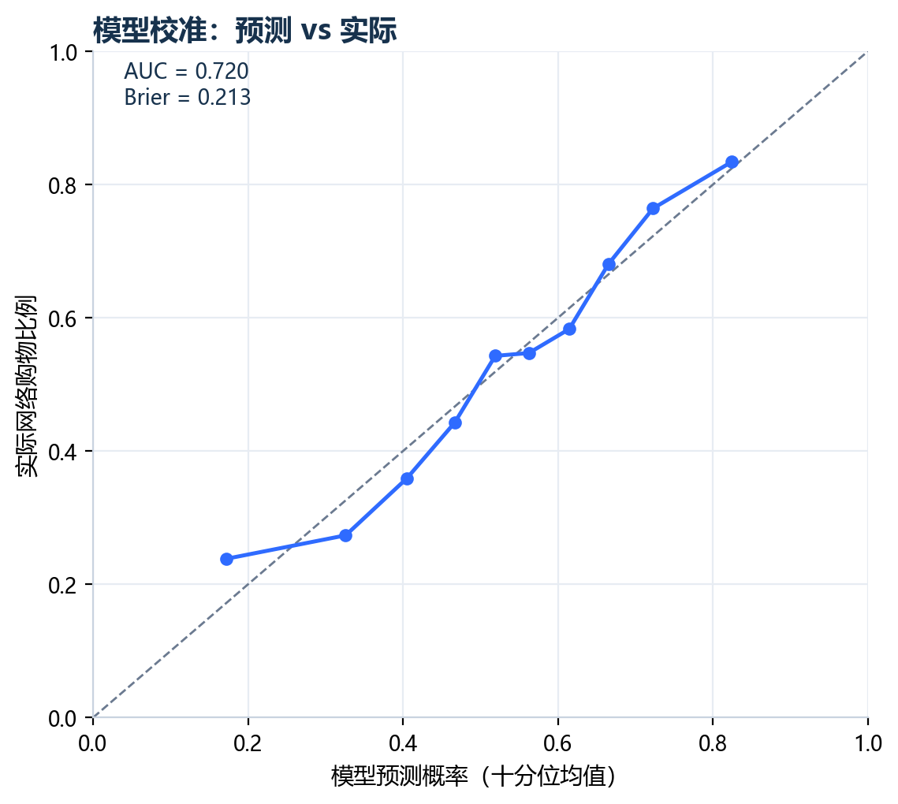

# CFPS 2022 农村上网居民网络购物采纳影响因素分析

> 生成时间：2026-10-21 11:01 ｜ 分析样本：N = 2,344 ｜ 数据：CFPS 2022


## 一、结论摘要

- 在 2,344 名农村移动互联网使用者中，**52.6%** 使用过网络购物。
- 年龄呈显著倒 U 型：预测概率在 **34.6 岁**左右达到峰值；30 岁约 62.7%，60 岁约 37.3%。
- 控制其他变量后，男性比女性的网络购物概率低 **11.6 个百分点**。
- 受教育年限每增加 1 年，网络购物概率平均提高 **1.17 个百分点**。
- 人均收入每提高 10%，网络购物概率平均提高约 **0.34 个百分点**。
- 同时使用电脑上网者，网络购物概率高 **13.0 个百分点**。
- 家庭人口规模、土地资产与网络购物无显著相关关系。
- 模型拟合：Pseudo R² = 0.111，AUC = 0.720。

> **口径提醒**：这里的“数字服务使用”具体指网络购物（qu92），样本仅限移动上网者（qu201=1），因此结论不能外推到所有农村居民，也不能解释为因果关系。原项目使用的 ft601 是“亲友借款待偿额”，并非数字服务采纳，已弃用。

## 二、样本构建

| 步骤                 |   样本量 | 说明                                 |
|:---------------------|---------:|:-------------------------------------|
| 家庭经济库原始样本   |    10726 | 每行一个家庭                         |
| 保留乡村家庭         |     4681 | urban22 == 0                         |
| 家庭库按 fid22 去重  |     4681 | 删除重复 0 行                        |
| 成人库原始样本       |    27001 | 每行一个成年人                       |
| 成人库按 pid 去重    |    27001 | 删除重复 0 行                        |
| 家庭—成人匹配        |     4266 | 按 resp1pid = pid 内连接             |
| 保留移动互联网使用者 |     2551 | qu201 == 1 (是)                      |
| 保留网络购物有效回答 |     2551 | qu92 ∈ {0, 1}                        |
| 核心变量完整样本     |     2344 | 删除年龄、教育、收入、土地资产等缺失 |

最终进入模型的样本为 **2,344** 人。网络购物采纳率为 **52.65%**。

## 三、描述统计

| 变量         |   样本量 |     均值 |   标准差 |   最小值 |   中位数 |   最大值 |
|:-------------|---------:|---------:|---------:|---------:|---------:|---------:|
| 网络购物采纳 |     2344 |    0.526 |    0.499 |    0.000 |    1.000 |    1.000 |
| 年龄         |     2344 |   44.517 |   13.051 |   16.000 |   44.000 |   85.000 |
| 年龄平方     |     2344 | 2152.052 | 1203.362 |  256.000 | 1936.000 | 7225.000 |
| 男性         |     2344 |    0.582 |    0.493 |    0.000 |    1.000 |    1.000 |
| 受教育年限   |     2344 |    9.017 |    3.994 |    0.000 |    9.000 |   19.000 |
| 家庭人口规模 |     2344 |    3.856 |    1.990 |    1.000 |    4.000 |   13.000 |
| 人均收入对数 |     2344 |    9.851 |    1.032 |    0.000 |    9.885 |   14.796 |
| 土地资产对数 |     2344 |    6.602 |    4.987 |    0.000 |    8.964 |   14.994 |
| 电脑上网     |     2344 |    0.171 |    0.377 |    0.000 |    0.000 |    1.000 |

## 四、模型比较

| 模型   |   样本量 |   Pseudo R²/R² |       AIC |       BIC |    AUC |   Brier |
|:-------|---------:|---------------:|----------:|----------:|-------:|--------:|
| Probit |     2344 |         0.1106 | 2902.1901 | 2954.0266 | 0.7197 |  0.2133 |
| Logit  |     2344 |         0.1111 | 2900.5678 | 2952.4043 | 0.7203 |  0.2132 |
| LPM    |     2344 |         0.1403 | 3059.5364 | 3111.3729 | 0.7190 |  0.2143 |

Probit 与 Logit 的边际效应方向和量级高度一致；LPM 作为稳健性参考。Probit/Logit 使用 HC1 异方差稳健标准误。

## 五、平均边际效应（Probit）

| 变量         |   平均边际效应 |   标准误 |   p 值 |   95% CI 下限 |   95% CI 上限 | 显著性   |
|:-------------|---------------:|---------:|-------:|--------------:|--------------:|:---------|
| 年龄         |         0.0253 |   0.0057 | 0.0000 |        0.0142 |        0.0364 | ***      |
| 年龄平方     |        -0.0004 |   0.0001 | 0.0000 |       -0.0005 |       -0.0002 | ***      |
| 男性         |        -0.1161 |   0.0190 | 0.0000 |       -0.1534 |       -0.0788 | ***      |
| 受教育年限   |         0.0117 |   0.0028 | 0.0000 |        0.0062 |        0.0173 | ***      |
| 家庭人口规模 |        -0.0000 |   0.0054 | 0.9954 |       -0.0106 |        0.0106 |          |
| 人均收入对数 |         0.0353 |   0.0116 | 0.0023 |        0.0126 |        0.0580 | ***      |
| 土地资产对数 |        -0.0020 |   0.0021 | 0.3574 |       -0.0061 |        0.0022 |          |
| 电脑上网     |         0.1297 |   0.0299 | 0.0000 |        0.0711 |        0.1883 | ***      |

注：年龄与年龄平方的边际效应需结合年龄曲线解读，不能单独把 age² 的系数当作业务结论。

## 六、分群体观察

| 维度           | 分组        |   样本量 |   采纳率 |   95% CI 下限 |   95% CI 上限 |
|:---------------|:------------|---------:|---------:|--------------:|--------------:|
| 年龄组         | 16–29 岁    |      320 |   0.6406 |        0.5867 |        0.6912 |
| 年龄组         | 30–39 岁    |      597 |   0.7085 |        0.6708 |        0.7436 |
| 年龄组         | 40–49 岁    |      539 |   0.5603 |        0.5181 |        0.6016 |
| 年龄组         | 50–59 岁    |      591 |   0.4095 |        0.3705 |        0.4496 |
| 年龄组         | 60 岁及以上 |      297 |   0.2088 |        0.1664 |        0.2585 |
| 受教育程度     | 小学及以下  |      629 |   0.4070 |        0.3693 |        0.4458 |
| 受教育程度     | 初中        |     1000 |   0.5370 |        0.5060 |        0.5677 |
| 受教育程度     | 高中/中专   |      374 |   0.5214 |        0.4708 |        0.5715 |
| 受教育程度     | 大专        |      214 |   0.6963 |        0.6316 |        0.7540 |
| 受教育程度     | 本科及以上  |      127 |   0.7638 |        0.6828 |        0.8292 |
| 人均收入四分位 | 收入 Q1     |      591 |   0.3824 |        0.3441 |        0.4222 |
| 人均收入四分位 | 收入 Q2     |      581 |   0.5267 |        0.4860 |        0.5670 |
| 人均收入四分位 | 收入 Q3     |      599 |   0.5643 |        0.5243 |        0.6034 |
| 人均收入四分位 | 收入 Q4     |      573 |   0.6353 |        0.5951 |        0.6736 |
| 电脑上网       | 否          |     1943 |   0.4802 |        0.4580 |        0.5024 |
| 电脑上网       | 是          |      401 |   0.7506 |        0.7060 |        0.7905 |

## 七、图表









## 八、方法与局限

1. **结果变量**：qu92“是否网上购物”，1 = 是，0 = 否；这是数字服务使用的一个可观测切面，不等同于全部数字服务。
2. **样本范围**：仅农村（urban22=0）、移动上网（qu201=1）且核心变量完整的成年受访者。qu92 对未上网者不适用，若把所有农村居民纳入会产生选择性偏误。
3. **模型**：Probit 为主，Logit 与 LPM 作为稳健性参考；报告平均边际效应，便于解释概率变化。
4. **标准误**：HC1 异方差稳健标准误；未使用 CFPS 调查权重，因此结果不代表全国代表性估计。
5. **识别**：横截面数据，只能报告条件相关关系，不能声称因果效应；电脑上网、收入等变量可能与不可观测因素相关。
6. **缺失值**：将 CFPS 负值特殊编码（-10、-9、-8、-2、-1）及 79 统一设为缺失，采用完整案例回归；未做多重插补。
7. **数据合规**：CFPS 原始数据与行级衍生数据不随项目分享；仓库只保留汇总结果与代码。

## 九、可复现性

```bash
python analysis.py --fam <cfps2022famecon_202410.dta> --adult <cfps2022person_202410.dta> --out output/real
```

---
*本报告由 analysis.py 自动生成，所有数字均来自实际 CFPS 2022 数据运行结果。*